# Hi, I'm Kusai

I build retrieval and data systems in Python: RAG pipelines, multi-agent setups, and the data pipelines that feed them. Lately I've been working on tracing RAG failures back to the step that caused them, in [rag-pipeline-failure-forensics](https://github.com/RottenBanana420/rag-pipeline-failure-forensics).

- Working on: RAG evaluation and observability, multi-agent workflows, data pipelines
- Ask me about: hybrid retrieval (BM25 + dense, rank fusion), LLM-as-judge evaluation, tabular ML in scikit-learn and XGBoost
- Fun fact: I captained my college soccer team ⚽

  

## Tech stack

            

## Projects

<!-- PROJECTS:START -->
<!-- PROJECTS:END -->

## Recent activity

<!--START_SECTION:activity-->
<!--END_SECTION:activity-->

## GitHub stats

<!-- STATS:START -->

<!-- STATS:END -->
